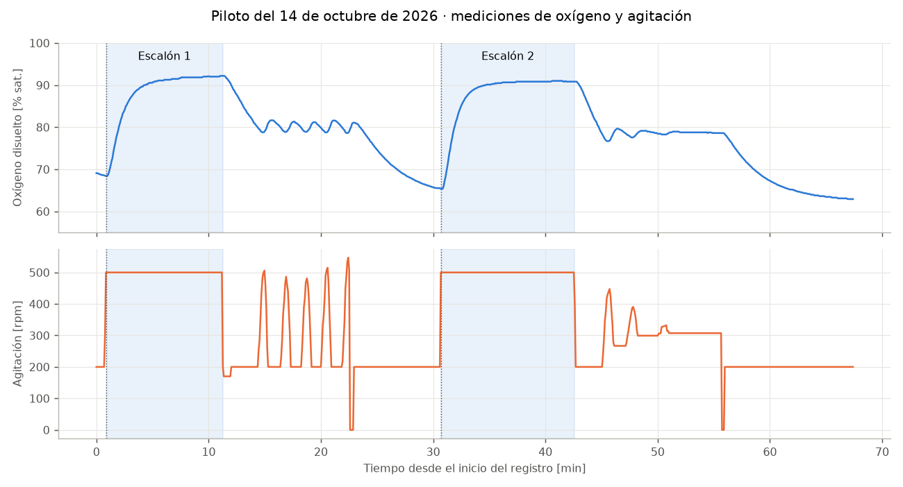
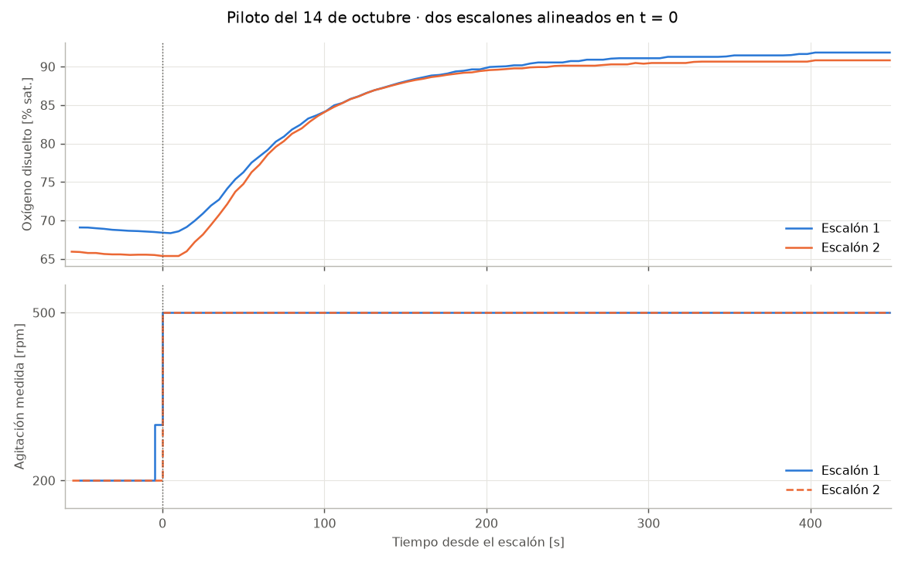

## A. Preparación del reactor y organización

- **Configuración común:** 5 L de líquido, 30 °C y aire fijo a **0.5 vvm (2.5 L/min)** durante toda la actividad. Cascada de oxígeno con **solo agitación**, mínimo 200 y máximo 1200 rpm (Span = 1000 rpm). Verificar estos límites en pantalla antes de calcular.
- **Preparación propuesta para el taller:** 10 g/L de azúcar (50 g en 5 L) y 3 g/L de levadura seca (15 g). Rehidratar la levadura unos 15 min en aproximadamente 100 mL de agua tibia e inocular unos 20 min antes del primer equipo. Calibrar previamente la sonda al 100 % con aire a 30 °C.
- **Antes de cada escalón:** MAN a 200 rpm, oxígeno estable y registro activo. Mantener fijos aire, temperatura y composición durante la medición. Revisar que la agitación efectivamente pase a 500 rpm.
- **Entre equipos:** volver a MAN 200 rpm en el minuto 40. La recuperación observada tardó al menos 10 min; la explicación del siguiente equipo puede aprovechar parte de ese tiempo, pero no sustituye verificar estabilidad. Prever una pausa si hace falta.

## B. Ensayos del 14 de octubre de 2026

Se registraron dos escalones de **200 a 500 rpm** en el mismo lote, separados aproximadamente 30 min, en la hoja `B1.20261014.2` del Excel. Las notas del piloto indican **5 g/L de azúcar**; la preparación propuesta arriba usa 10 g/L. Por tanto, no presentar el piloto como una repetición con condiciones idénticas al taller. Verificar la concentración del día y anotarla.

El cultivo evolucionó entre escalones: el oxígeno inicial bajó de 68.8 a 65.7 %. Cada equipo debe obtener su propio valor inicial y final. Las cifras siguientes son referencias para revisar cálculos o trabajar con el piloto cuando no alcance el tiempo para obtener una curva completa.

En esta gráfica se muestran las mediciones originales de oxígeno y agitación. El registro disponible no contiene el modo MAN/AUTO, el setpoint ni los parámetros Xp/TI: las variaciones posteriores a cada escalón deben interpretarse junto con las notas de operación, sin asignarles automáticamente un método.

Ambas curvas comienzan en el instante en que cambia la agitación. Aunque el oxígeno inicial cambia, el incremento total es parecido: 23.2 y 25.3 puntos porcentuales. El escalón de 300 rpm representa 30 % de salida con el Span de 1000 rpm usado en el recálculo.

## C. Ajustes recalculados para cada método

Estos resultados se obtuvieron **después del piloto**, leyendo las curvas con los criterios de la sección 7 y convirtiendo la ganancia con **Span = 1000 rpm**. Proceden del bloque `por_metodo` de los archivos de `resultados/`; los bloques `modelos` comparan otras estimaciones y no son los valores asignados a cada equipo.

| Lectura o ajuste | Escalón 1 | Escalón 2 |
|---|---|---|
| Oxígeno inicial / final [%] | 68.8 / 92.0 | 65.7 / 90.9 |
| Cambio de oxígeno [puntos] / $K_{p,\text{norm}}$ | 23.2 / 0.77 | 25.3 / 0.84 |
| Z-N: $\theta$ / $\tau$ [s] | 18 / 96 | 18 / 85 |
| **Z-N: Xp [%] / TI [s]** | **16.5 / 61** | **19.7 / 60** |
| SIMC: $\theta$ / $\tau$ [s] | 16 / 77 | 16 / 68 |
| **SIMC: Xp [%] / TI [s]** | **31.9 / 77** | **38.6 / 68** |
| ITAE: $\theta$ / $\tau$ [s] | 22 / 71 | 22 / 61 |
| **ITAE: Xp [%] / TI [s]** | **28.0 / 47** | **35.7 / 45** |

En todos los casos: **TD = 0 s** y **Deadband = 1.5 %**. No reutilizar sin comprobar los valores de Xp si cambió la configuración de la cascada.

### Comprobación de los cálculos

| Método | Comprobación de la lectura | Cómo interpretar su ajuste |
|---|---|---|
| **Ziegler–Nichols** | Trazar la tangente sobre el tramo de subida más pronunciado, evitando elegir un salto aislado de ruido. Medir $\theta$ desde el escalón al cruce inferior; $\tau$ es la separación entre los dos cruces. | Dio el Xp más pequeño: una corrección proporcional más intensa. Vigilar oscilación y límites de rpm. |
| **SIMC** | Usar el inicio visible (umbral de 0.5 puntos sobre $y_0$) y el tiempo al 63.2 % del cambio. Restar el tiempo muerto para obtener $\tau$. El umbral es una aproximación didáctica y es sensible al ruido. | Aquí se eligió $\tau_c = \theta$. Un $\tau_c$ mayor en la regla general reduce la ganancia y permite un arranque más suave; recalcular también TI si se cambia esa elección. |
| **ITAE para perturbaciones** | Leer 28.3 % y 63.2 % **del cambio total**, no 28.3 y 63.2 % de saturación. Ambos tiempos parten del escalón. Revisar potencias y que $\theta$ resulte positivo. | Dio un TI más corto que SIMC: la corrección integral es más rápida. Su objetivo original son perturbaciones; los cambios de setpoint del taller no verifican ese objetivo. |

**Ejemplo de revisión, segundo escalón:** $\Delta y = 25.26$ puntos y $K_{p,\text{norm}} = 25.26/30 = 0.842$. Para ITAE, los niveles son aproximadamente 72.80 y 81.62 % de saturación, alcanzados a 42.21 y 83.04 s. Así, $\tau = 1.5(83.04-42.21) = 61.25$ s y $\theta = 83.04-61.25 = 21.79$ s. La regla da $K_{c,\text{norm}} = 2.80$, por lo que Xp = 35.7 % y TI = 45.0 s.

## D. Ajustes ensayados en automático

Las notas de operación del 14 de octubre reportan estos ajustes con **SP = 80 %**:

| Ajuste introducido | Observación anotada | Qué permite concluir |
|---|---|---|
| Xp = 10 %, TI = 80 s | Oscilación sostenida de oxígeno (aprox. 79–81.6 %) y agitación entre 200 y unas 500 rpm. | Ese ajuste produjo oscilación en aquellas condiciones. |
| Xp = 18 %, TI = 120 s, Deadband = 1.5 % | Oxígeno cerca de 79 % y agitación aproximadamente constante en 307 rpm. | Ese ajuste resultó más estable en esa prueba. Estar cerca de 79 % es compatible con la banda de observación alrededor de 80 %. |

**Estos dos ajustes no equivalen a probar los tres métodos de la tabla anterior.** Durante la sesión se usaron estimaciones preliminares de $\tau$ a partir del tiempo de estabilización ($\tau \approx t_s/4$) y un Span supuesto de 600 rpm. El recálculo posterior usa las lecturas de las curvas y Span = 1000 rpm. Por eso **Xp = 18 %, TI = 120 s no debe presentarse como el resultado de SIMC**, ni como una validación experimental de los ajustes recalculados.

Con el mismo TI y configuración, bajar Xp aumenta la acción proporcional; con el mismo Xp, bajar TI acelera la acción integral. Entre los dos ajustes ensayados cambiaron ambos parámetros, de modo que no puede atribuirse toda la diferencia a uno solo.

## E. Revisión y corrección del ajuste

1. **Revisar antes de AUTO:** escala de oxígeno, Span real, conversión $X_p = 100/K_{c,\text{norm}}$, TI en segundos, TD = 0 y setpoint alcanzable. Si la salida aumenta, la agitación debe aumentar; en esta zona de operación se espera que eso eleve el oxígeno.
2. **Empezar por el ajuste calculado y registrar qué se introdujo.** Observar oxígeno y rpm juntos. Registrar tiempo de entrada en la banda, si permanece ahí y si la agitación oscila o se mantiene en un límite. No prometer que una regla garantiza estabilidad.
3. **Si hay oscilación sostenida:** volver a MAN si no conviene continuar. Revisar primero curva, ruido, unidades y saturación. Para una nueva prueba más suave se puede aumentar Xp o aumentar TI; cambiar un parámetro a la vez, anotar el nuevo valor y dejar tiempo para observar. Es una corrección posterior, distinta del resultado original del método.
4. **Si responde demasiado lento:** descartar primero setpoint inalcanzable, límite de agitación o cultivo todavía cambiante. Si el problema es el ajuste, reducir Xp o TI con el instructor, de uno en uno. Mantener el aire fijo.
5. **Si queda pegado en 200 o 1200 rpm:** comprobar si la agitación disponible basta para llegar al setpoint. Una salida limitada no se resuelve simplemente aumentando la ganancia. Si faltan minutos, documentar la limitación y cerrar la prueba.

**Aspectos del piloto que afectan la lectura:** el pH bajó aproximadamente de 5.8 a 4.5 y el oxígeno a 200 rpm siguió descendiendo con el tiempo. El intervalo automático fue de unos 5 s: con registro manual cada 10 s, la incertidumbre al leer un tiempo muerto de 15–22 s es apreciable. No exigir que la lectura manual reproduzca los decimales del análisis computacional.

Si el oxígeno inicial sube inesperadamente, revisar agitación, aire, sonda y estado del cultivo. El agotamiento del azúcar es una posibilidad, no una conclusión basada solo en la señal de oxígeno. Cualquier adición cambia las condiciones: anotarla y esperar un nuevo estado estable antes de repetir el escalón.

## F. Saturación y acumulación integral

Comprobar la protección contra acumulación integral disponible y su configuración. Si la salida permanece en un límite, revisar capacidad de transferencia y setpoint antes de aumentar la acción integral. Registrar modo, SP, parámetros aplicados, oxígeno y rpm. Conservar el ajuste calculado y cualquier modificación posterior, con su motivo. Limitar las conclusiones a las condiciones y al tiempo observados.
