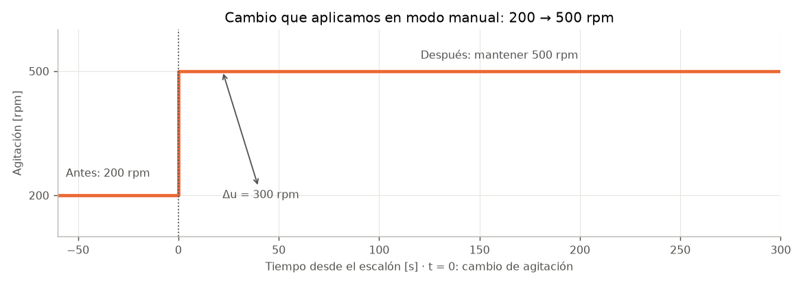
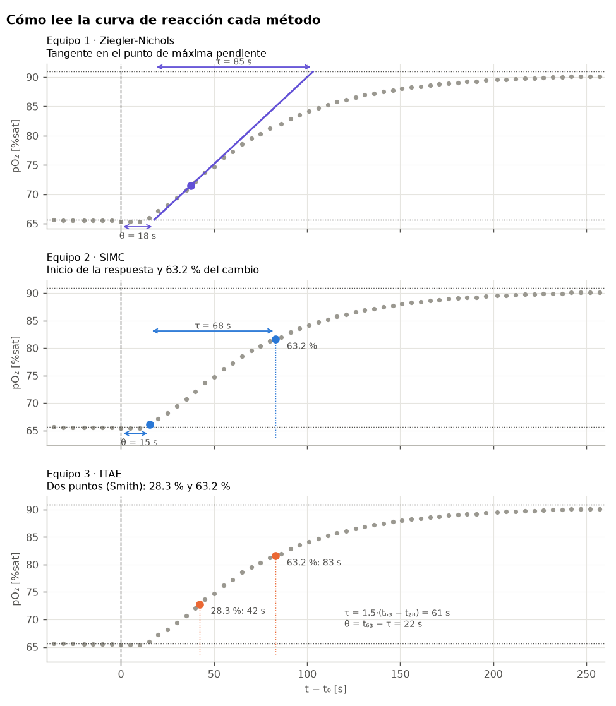

**Taller:** Afinación del control de oxígeno disuelto en un biorreactor

**Duración:** máximo 45 min por equipo (3 equipos de 6 personas, uno tras otro en el mismo biorreactor)

**Equipo:** Sartorius Biostat B, vasija de 8 L

# 1. Control de oxígeno disuelto

Las células necesitan condiciones adecuadas para crecer y producir: temperatura, pH y oxígeno disuelto, entre otras. Esas condiciones cambian durante el cultivo; por ejemplo, al aumentar la cantidad de células puede aumentar el consumo de oxígeno.

**Controlar un bioproceso significa** medir una variable, compararla con el valor deseado y hacer ajustes para mantenerla cerca de ese valor. Esto ayuda a cuidar el cultivo, obtener resultados reproducibles y reducir la variación entre lotes.

Pensemos en el oxígeno disuelto: una sonda lo mide y el controlador decide si debe aumentar o disminuir la agitación. Así ajusta la entrada de oxígeno al líquido según lo que necesita el proceso. No controla directamente a las células, sino las condiciones de su entorno.

| Elemento | Qué significa | En esta práctica |
|---|---|---|
| Variable controlada ($y$) | Lo que queremos mantener | Oxígeno disuelto, indicado como $pO_2$ (% de saturación) |
| Setpoint ($SP$) | El valor que queremos alcanzar | 80 % de saturación, si es alcanzable en la prueba |
| Error ($e$) | Cuánto falta para llegar: $e = SP - y$ | Si queremos 80 % y medimos 75 %, el error es +5 puntos porcentuales |
| Variable manipulada ($u$) | Lo que podemos ajustar | Agitación (rpm: revoluciones por minuto) |
| Perturbación | Un cambio que afecta la variable controlada | Mayor consumo de oxígeno por las células |
| Controlador | El que calcula el ajuste a partir de la medición | El controlador de la torre Biostat B |

En **modo manual (`MAN`, lazo abierto)**, una persona fija la agitación.

En **modo automático (`AUTO`, lazo cerrado)**, el controlador compara continuamente la medición con el setpoint y ajusta la agitación. El aire permanecerá fijo durante toda la práctica.

# 2. Controlador PID y operación PI

Un controlador muy utilizado es el **PID**, llamado así por sus acciones proporcional, integral y derivativa. Podemos entenderlas como tres preguntas:

| Acción | Pregunta que responde | Qué aporta |
|---|---|---|
| **P: proporcional** | ¿Qué tan lejos estoy del valor deseado ahora? | Corrige más cuando el error es mayor. Por sí sola puede dejar una diferencia persistente con el SP. |
| **I: integral** | ¿Cuánto error se ha acumulado? | Sigue ajustando cuando la diferencia persiste y ayuda a eliminarla. Una acción demasiado fuerte puede causar oscilaciones. |
| **D: derivativa** | ¿Qué tan rápido está cambiando el error? | Puede ayudar a frenar una respuesta excesiva, pero también amplifica el ruido de la medición. |

**Se pueden usar las combinaciones que el proceso requiera:** P, PI, PD o PID. Aquí usaremos **PI**: la acción integral ayuda a corregir diferencias persistentes y omitimos la derivativa porque las burbujas pueden producir ruido en la señal de oxígeno.

## Ecuación del controlador PID

La idea es una suma: **salida = valor base + corrección P + corrección I + corrección D**. Una forma habitual de escribirla es:

$$u(t) = u_0 + K_c\,e(t) + \frac{K_c}{T_I}\int_0^t e(\xi)\,d\xi + K_c\,T_D\,\frac{de(t)}{dt}$$

No hace falta resolver integrales ni derivadas para realizar la práctica. Basta con leer cada parte:

- $u(t)$ es la salida que calcula el controlador en ese momento.
- $e(t)$ es el error actual. El término $K_c\,e(t)$ es la corrección **P**: multiplicar el error por una ganancia.
- El símbolo $\int$ significa **acumular el error con el tiempo**. El término que lo contiene es la corrección **I**.
- $de/dt$ significa **qué tan rápido cambia el error**. El último término es la corrección **D**; al usar PI lo omitimos ($T_D = 0$).

Las constantes son $K_c$ (ganancia), $T_I$ (tiempo integral) y $T_D$ (tiempo derivativo). Con el mismo error, un $K_c$ mayor produce una corrección mayor. Con el mismo $K_c$, un $T_I$ menor hace que la acción integral corrija más rápido. En algunos textos los tiempos aparecen como $\tau_I$ y $\tau_D$: significan lo mismo.

Algunos controladores utilizan los coeficientes $K_i=K_c/T_I$ y $K_d=K_cT_D$ de la forma paralela. Estos coeficientes no son los tiempos $T_I$ y $T_D$. En esta práctica mantendremos $K_p$ para la ganancia del proceso y $K_c$ para la del controlador; después convertiremos $K_c$ a la banda proporcional Xp que solicita Biostat.

Si la salida alcanza su límite y el error persiste, la acción integral puede seguir acumulándose. Esta acumulación, conocida como *windup*, puede retrasar la recuperación cuando el proceso vuelve a una zona alcanzable. El instructor comprobará qué protección contra acumulación integral ofrece la configuración instalada.

## Ajuste de los parámetros de control

**Afinar** significa encontrar valores adecuados para esas constantes. Un ajuste demasiado intenso puede hacer que la agitación y el oxígeno oscilen; uno demasiado suave puede tardar demasiado en corregir. Buscamos una respuesta útil para el cultivo y el equipo.

Una forma de empezar es usar **métodos semiempíricos**: reglas que otros ingenieros han desarrollado a lo largo de los años combinando modelos sencillos con observaciones de procesos reales. Medimos cómo responde nuestro reactor a un cambio conocido y usamos esa información en las reglas. El resultado es un ajuste inicial que después debemos comprobar en automático, no una garantía de comportamiento perfecto.

En esta práctica cambiaremos la agitación, observaremos el oxígeno, calcularemos un ajuste PI y comprobaremos cómo responde. Cada equipo usará una regla distinta para comparar los resultados.

# 3. Objetivo de la práctica

Obtener la curva de reacción del oxígeno disuelto ($pO_2$) ante un escalón en la agitación, sacar de ella un modelo sencillo y usarlo para calcular los parámetros de un controlador PI con un método semiempírico. Después se comprueba en el equipo cómo responde el lazo cerrado. Participan 3 equipos de 6 personas, con 45 minutos como máximo por equipo. El aire se mantiene en 0.5 vvm (2.5 L/min para 5 L de líquido) en todas las etapas; vvm significa litros de gas por litro de líquido por minuto.

Cada equipo usa un método distinto y al final se comparan los tres:

| Equipo | Método | Idea |
|---|---|---|
| 1 | Ziegler-Nichols (curva de reacción) | Respuesta rápida; acepta oscilación |
| 2 | SIMC (Skogestad) | Busca un compromiso entre rapidez y suavidad |
| 3 | ITAE para perturbaciones | Busca reducir el error persistente ante perturbaciones |

# 4. El sistema

| Parámetro | Valor |
|---|---|
| Volumen de trabajo | 5 L de agua con 10 g/L de azúcar (50 g) |
| Biomasa | Levadura seca (*S. cerevisiae*), 3 g/L (15 g), inoculada ~20 min antes del primer equipo |
| Temperatura | 30 °C (lazo de temperatura activo) |
| Aireación | 0.5 vvm fijos (2.5 L/min; es el mínimo del equipo) |
| Agitación de reposo | 200 rpm en modo manual |
| Escalón | 200 → 500 rpm ($\Delta u = 300$ rpm) |
| Cascada de $pO_2$ (solo agitador) | $N_{\min} = 200$ rpm, $N_{\max} = 1200$ rpm → **Span = 1000 rpm** |

## Transferencia y consumo de oxígeno

El oxígeno que pasa del gas al líquido compite con el que consumen las levaduras. La velocidad volumétrica de transferencia de oxígeno puede expresarse como:

$$\mathrm{OTR}=k_La\,(C^*-C_L)$$

Aquí $k_La$ es el coeficiente volumétrico de transferencia, $C^*$ la concentración de oxígeno en equilibrio con el gas y $C_L$ la concentración en el líquido. OTR es la sigla de la velocidad de transferencia de oxígeno. Si el volumen permanece constante y se considera un líquido bien mezclado, el balance simplificado es:

$$\frac{dC_L}{dt}=\mathrm{OTR}-\mathrm{OUR}$$

OUR es la velocidad volumétrica de consumo de oxígeno por las células. Cuando transferencia y consumo se igualan, la concentración se mantiene estable. Al aumentar la agitación se favorece la transferencia y el oxígeno disuelto puede subir hasta un nuevo equilibrio. Durante los pocos minutos de la medición suponemos que el consumo cambia poco. No necesitamos calcular $k_La$ ni OUR para realizar la práctica.

En otros montajes también se puede actuar sobre el caudal de gas o su fracción de oxígeno. El caudal puede modificar la transferencia y la formación de espuma; el enriquecimiento cambia la concentración de equilibrio $C^*$. En este taller se modifica únicamente la agitación y se mantiene el aire fijo.

# 5. La curva de reacción del proceso

La curva de reacción es la respuesta de la variable controlada a un escalón en la variable manipulada con el controlador desconectado (lazo abierto, modo `MAN`). Muestra cuánto cambia la salida, cuánto tarda en empezar a cambiar y qué tan rápido llega a su nuevo valor. Ziegler y Nichols (1942) propusieron sintonizar controladores a partir de esta sola prueba, sin necesidad de un modelo teórico; por eso estos métodos se llaman *semiempíricos*.

En esta práctica:

- Variable manipulada ($u$): agitación, de 200 a 500 rpm.
- Variable controlada ($y$): $pO_2$ en % de saturación.

La línea vertical marca el cambio de agitación. Antes del instante cero mantenemos 200 rpm; después mantenemos 500 rpm mientras medimos el oxígeno. Este dibujo muestra el cambio que ordenamos en MAN; la respuesta del oxígeno se observa después.

Para que la curva sea útil:

1. El proceso debe estar estable antes del escalón ($pO_2$ estable).
2. Se hace un solo cambio, de golpe, y no se toca nada más.
3. Se espera hasta que la salida llegue a un nuevo valor estable.
4. El escalón debe ser lo bastante grande para verse claramente sobre el ruido, pero no tanto que el sistema salga de la zona de interés (aquí, entre ~65 y ~91 %).

La curva se resume con un modelo de primer orden con tiempo muerto (FOPDT):

No hace falta usar una función de transferencia: para esta actividad basta describir la curva con tres números.

- $K_p$ (ganancia): cuánto cambia el $pO_2$ por cada unidad de cambio en la agitación. $K_p = \Delta y/\Delta u$.
- $\theta$ (tiempo muerto): lo que tarda la señal en empezar a moverse. Incluye el mezclado y la respuesta de la sonda.
- $\tau$ (constante de tiempo): una medida de la rapidez de la respuesta. En este modelo, tras el tiempo muerto, en un tiempo $\tau$ se recorre aproximadamente el 63 % del cambio total; no significa que ya haya terminado.

Para un escalón aplicado en $t_0$, la respuesta del modelo después del tiempo muerto es:

$$y(t)=y_0+\Delta y\left[1-e^{-(t-t_0-\theta)/\tau}\right],\qquad t\geq t_0+\theta$$

Antes de $t_0+\theta$, el modelo conserva $y=y_0$. Al transcurrir una constante de tiempo después del tiempo muerto, $t-t_0-\theta=\tau$, la fracción recorrida es:

$$\frac{y-y_0}{\Delta y}=1-e^{-1}\approx0.632=63.2\,\%$$

Por eso el tiempo al 63.2 %, contado desde el escalón, es $t_{63}=\theta+\tau$. Se trata de un modelo de primer orden porque describe la dinámica mediante una primera derivada. En este caso, τ caracteriza la respuesta del proceso medido, incluyendo transferencia, mezcla y medición; no es la constante de tiempo de la sonda aislada.

Todos los equipos leen igual $y_0$, $y_\infty$ y $\Delta y = y_\infty - y_0$. Lo que cambia entre métodos es cómo se leen $\theta$ y $\tau$ (sección 7).

# 6. Unidades y normalización de la salida

$\Delta$ se lee «cambio»: valor final menos valor inicial. Por ejemplo, de 200 a 500 rpm, $\Delta u = 300$ rpm. $y_0$ es la lectura inicial y $y_\infty$ la lectura final estable; el subíndice $\infty$ no implica esperar infinitamente.

La salida de Biostat va de 0 a 100 % y se traduce en 200 a 1200 rpm en la configuración de esta práctica. Por tanto, el intervalo o **Span** es $1200 - 200 = 1000$ rpm. El escalón de 300 rpm equivale a 30 % de esa salida:

$$\Delta u_\% = 100\,\frac{\Delta u}{\text{Span}} = 100\,\frac{300}{1000} = 30\ \%$$

Para usar las reglas de la siguiente sección calculamos:

$$K_{p,\text{norm}} = \frac{y_\infty-y_0}{\Delta u_\%}$$

Esta ganancia describe **el proceso**: cuánto cambia el oxígeno por cada punto porcentual de salida. No es la ganancia $K_c$ **del controlador**. Por ejemplo, si el oxígeno pasa de 65 a 90 %, el cambio es 25 puntos y $K_{p,\text{norm}} = 25/30 = 0.83$.

Usa segundos en todos los tiempos. Las reglas darán $K_{c,\text{norm}}$ y el tiempo integral **TI**; después convertiremos la ganancia al campo **Xp** de la pantalla, como explica la nota final.

# 7. Estimación del modelo y reglas de ajuste PI

Para esta actividad asignamos a cada equipo una forma de estimar $\theta$ y $\tau$. SIMC e ITAE también pueden aplicarse a modelos obtenidos con otros procedimientos: esta elección es didáctica. Por tanto, la comparación incluye tanto la regla de ajuste como la lectura de la curva:

## Equipo 1: Ziegler-Nichols, recta tangente

1. Busca el tramo de **máxima pendiente**: entre qué dos lecturas consecutivas subió más el $pO_2$.
2. Traza una recta por ese tramo y prolóngala hacia abajo hasta $y_0$ y hacia arriba hasta $y_\infty$.
3. $\theta$ = tiempo desde $t_0$ hasta donde la recta cruza $y_0$.
4. $\tau$ = tiempo entre el cruce con $y_0$ y el cruce con $y_\infty$.

$$K_{c,\text{norm}} = \frac{0.9}{K_{p,\text{norm}}}\cdot\frac{\tau}{\theta}\qquad\qquad TI = 3.33\,\theta$$

## Equipo 2: SIMC, inicio de la respuesta y 63.2 %

1. $\theta$ = tiempo desde $t_0$ hasta la **primera lectura que sube 0.5 % o más sobre $y_0$** (cuando la respuesta empieza a notarse).
2. Calcula $y_{63} = y_0 + 0.632\,\Delta y$ y busca en qué tiempo $t_{63}$ se alcanza.
3. $\tau = t_{63} - \theta$ (con $t_{63}$ medido desde $t_0$).

$$K_{c,\text{norm}} = \frac{1}{K_{p,\text{norm}}}\cdot\frac{\tau}{2\theta}\qquad\qquad TI = \min(\tau,\ 8\theta)$$

Aquí $\min$ significa «elige el menor de los dos valores». Por ejemplo, si $\tau = 70$ s y $8\theta = 160$ s, TI = 70 s.

(Es la regla SIMC con $\tau_c = \theta$: $K_c = \tau / [K_p(\tau_c+\theta)]$, $\tau_I = \min[\tau, 4(\tau_c+\theta)]$.)

## Equipo 3: ITAE, dos puntos (Smith)

ITAE da más peso al error que persiste con el tiempo. En las fórmulas siguientes, usa la tecla de potencia de la calculadora para los exponentes decimales; primero calcula el cociente $\theta/\tau$.

1. Calcula $y_{28} = y_0 + 0.283\,\Delta y$ y $y_{63} = y_0 + 0.632\,\Delta y$.
2. Busca los tiempos $t_{28}$ y $t_{63}$ (medidos desde $t_0$).
3. $\tau = 1.5\,(t_{63} - t_{28})$ y $\theta = t_{63} - \tau$.

$$K_{c,\text{norm}} = \frac{0.859}{K_{p,\text{norm}}}\left(\frac{\theta}{\tau}\right)^{-0.977}\qquad\qquad TI = \frac{\tau}{0.674}\left(\frac{\theta}{\tau}\right)^{0.680}$$

**Antes de usar las reglas:** $K_{p,\text{norm}}$, $\theta$ y $\tau$ deben ser positivos. Si el tiempo muerto parece cero o sale negativo, revisar la lectura con el instructor; no dividir entre cero.

**En los tres casos:** $X_p = 100/K_{c,\text{norm}}$, **TD = 0 s**, **Deadband = 1.5 %**. TD se deja en cero porque las burbujas meten ruido en la señal de pO₂ y la acción derivativa lo amplificaría.

# Conversión de parámetros a Xp, TI y TD

En la configuración de esta práctica, la DCU pide **Xp, TI y TD**. TI es el tiempo integral en segundos y TD el derivativo (aquí, 0 s). **Xp es la banda proporcional**, por lo que no debemos escribir directamente la ganancia $K_c$ en ese campo.

Las reglas de la sección 7 usan una salida normalizada de 0 a 100 %. Con el oxígeno expresado sobre una escala de 0 a 100 % de saturación:

$$X_p = \frac{100}{K_{c,\text{norm}}}$$

Por ejemplo, si calculamos $K_{c,\text{norm}} = 2.5$ y $T_I = 70$ s, introducimos **Xp = 40 %, TI = 70 s y TD = 0 s**. Una banda Xp menor produce una corrección proporcional mayor. En ese ejemplo, un error de 4 puntos de oxígeno aporta una corrección P de 10 puntos de salida, equivalentes a 100 rpm con Span = 1000 rpm; la acción integral se suma a esa corrección.

Si el cálculo se hizo con la agitación en rpm, en vez de porcentajes, la ganancia $K_c$ tendrá unidades de rpm por punto de oxígeno. En ese caso el atajo es **$X_p = \text{Span}/K_c$**. No mezclar esa ganancia con $K_{c,\text{norm}}$.

Antes de introducir valores, comprobar que la cascada usa solo agitación, sus límites reales y la escala de medición de oxígeno: si cambia el Span o la escala, cambia la conversión. La documentación de Sartorius describe [los campos XP, TI, TD y DEADB en sus controladores DCU](https://www.sartorius.com/download/10106/biostat-d-dcu-customer-presentation-v2-data.pdf); los límites y la configuración concreta deben verificarse en el Biostat B de la actividad.

# 8. Organización del equipo

1. **Operación:** cambia la agitación, introduce Xp/TI y cambia entre MAN y AUTO con el instructor.
2. **Tiempo:** marca el instante del escalón ($t_0$) y anuncia cada lectura.
3. **Registro:** anota oxígeno y rpm en la hoja de datos.
4. **Gráfica:** representa los datos y localiza los puntos que requiere el método.
5. **Cálculo:** obtiene las constantes con calculadora y las convierte a Xp y TI.
6. **Verificación y comparación:** revisa unidades y cálculos, registra la respuesta en automático y comparte los resultados.

# 9. Procedimiento (máximo 45 min por equipo)

| Min | Qué se hace | Agitador |
|---|---|---|
| 0–7 | Introducción y reparto de roles mientras el reactor se estabiliza. | MAN 200 rpm |
| 7–9 | Verificar pO₂ estable (cambio menor a 0.5 puntos en 1 min). Anotar $y_0$. | MAN 200 rpm |
| 9–17 | **Escalón:** cambiar de 200 a 500 rpm y marcar $t_0$. Registrar pO₂ cada 10 s durante 3 min, luego cada 30 s hasta estabilizarse. Anotar $y_\infty$. | MAN 500 rpm |
| 17–26 | Graficar y calcular $\Delta y$, $K_{p,\text{norm}}$, $\theta$, $\tau$, Xp y TI según el método del equipo. | MAN 500 rpm |
| 26–28 | Revisar cálculos y sentido de acción con el instructor. Introducir Xp y TI; TD = 0 s; Deadband = 1.5 %. | MAN 500 rpm |
| 28–35 | **Prueba de setpoint:** pasar a AUTO con SP = 80 % si es alcanzable. Registrar pO₂ y rpm cada 15 s; observar mínimo, oscilación y tiempo de entrada en la banda 80 ± 1.5 %. | AUTO |
| 35–40 | **Segundo cambio de setpoint:** si ya está estable, cambiar de 80 a 85 % solo si ambos valores son alcanzables. Registrar máximo y tiempo de entrada en 85 ± 1.5 %. Si no se estabilizó, continuar la primera observación. | AUTO |
| 40–41 | Regresar a MAN 200 rpm para iniciar la recuperación antes del siguiente equipo. | MAN 200 rpm |
| 41–45 | Completar la comparación y discutir resultados. | MAN 200 rpm |

Antes de activar AUTO, comprobar que un déficit de oxígeno produzca una acción que aumente la agitación. Con $e=SP-y$, una lectura inferior al SP da un error positivo; el sentido de acción configurado debe corregirlo.

**El aire permanece fijo a 0.5 vvm (2.5 L/min) durante toda la actividad.** El segundo cambio es una prueba de seguimiento de setpoint; no es una prueba de perturbación. El método ITAE se calcula con una regla diseñada para perturbaciones, pero aquí solo observamos su respuesta a cambios de setpoint.

**¿Por qué 80 %?** En el piloto, a 200 rpm el oxígeno estaba cerca de 65 % y a 500 rpm cerca de 91 %. Por eso 80 % quedaba dentro del intervalo observado. Cada equipo debe verificar su propia curva: el cultivo cambia con el tiempo. No usar un setpoint fuera del intervalo observado para estas pruebas.

**¿Qué significa 80 ± 1.5 %?** Una banda de observación de 78.5 a 81.5 % de saturación, es decir, ±1.5 puntos porcentuales. Se configura además Deadband = 1.5 %; el instructor debe comprobar cómo aplica esa zona muerta la versión de la DCU instalada.

**Si falta tiempo o estabilidad:** no calcular a partir de una curva incompleta. El instructor puede proporcionar la curva del piloto para practicar los cálculos y señalar qué datos se usaron. Si una prueba no termina antes de su límite, registrar «no se estabilizó durante el tiempo observado». La recuperación a 200 rpm puede requerir más de 10 minutos: comprobarla antes del siguiente escalón, usando una pausa entre equipos si hace falta.

# 10. Hoja de datos

**Equipo:** ______  **Método:** ☐ Ziegler-Nichols ☐ SIMC ☐ ITAE  **Hora del escalón ($t_0$):** ________

**Escalón**

| u₀ | u₁ | Δu | Span | Δu% = 100·Δu / Span |
|---|---|---|---|---|
| 200 rpm | 500 rpm | 300 rpm | ______ rpm | ______ % |

**Registro de pO₂** (t medido desde $t_0$)

| t [s] | pO₂ [%] | t [s] | pO₂ [%] | t [s] | pO₂ [%] |
|---|---|---|---|---|---|
| −60 | | 70 | | 210 | |
| −30 | | 80 | | 240 | |
| 0 | | 90 | | 270 | |
| 10 | | 100 | | 300 | |
| 20 | | 110 | | 330 | |
| 30 | | 120 | | 360 | |
| 40 | | 150 | | 390 | |
| 50 | | 180 | | 420 | |
| 60 | | | | 450 | |

**Planta**

| y₀ [%] | y∞ [%] | Δy = y∞ − y₀ [%] | Kp,norm = Δy / Δu% |
|---|---|---|---|
| | | | |

**Lectura de θ y τ** (llena solo la de tu método)

| Método | Lo que se lee | Valor |
|---|---|---|
| Ziegler-Nichols | Tramo de máxima pendiente (entre qué tiempos) | ____ a ____ s |
| | Cruce de la tangente con $y_0$ → $\theta$ | ____ s |
| | Cruce de la tangente con $y_\infty$ → $\tau$ = cruce $y_\infty$ − cruce $y_0$ | ____ s |
| SIMC | Primera lectura ≥ $y_0$ + 0.5 % → $\theta$ | ____ s |
| | $y_{63} = y_0 + 0.632\,\Delta y$ → $t_{63}$ | ____ % → ____ s |
| | $\tau = t_{63} - \theta$ | ____ s |
| ITAE | $y_{28} = y_0 + 0.283\,\Delta y$ → $t_{28}$ | ____ % → ____ s |
| | $y_{63} = y_0 + 0.632\,\Delta y$ → $t_{63}$ | ____ % → ____ s |
| | $\tau = 1.5\,(t_{63} - t_{28})$; $\theta = t_{63} - \tau$ | τ = ____ s; θ = ____ s |

**Sintonía para la DCU**

| Kc,norm | Xp = 100 / Kc,norm | TI | TD | Deadband |
|---|---|---|---|---|
| | ______ % | ______ s | 0 s | 1.5 % |

# 11. Comparación de los tres equipos

| | Equipo 1: Z-N | Equipo 2: SIMC | Equipo 3: ITAE |
|---|---|---|---|
| $\theta$ [s] / $\tau$ [s] / $K_{p,\text{norm}}$ | | | |
| Xp [%] / TI [s] | | | |
| Setpoint: pO₂ mínimo al bajar a 80 % | | | |
| Setpoint: tiempo para quedar en 80 ± 1.5 % [s] | | | |
| ¿Oscila la agitación? | | | |
| Segundo setpoint: pO₂ máximo al subir a 85 % (si se realizó) | | | |
| Segundo setpoint: tiempo para entrar en 85 ± 1.5 % [s] | | | |
| Intervalo final observado de pO₂ y duración [%, s] | | | |
| ¿La agitación alcanzó 200 o 1200 rpm? Indicar duración | | | |

La evaluación considera el mínimo por debajo de 80 % en la primera prueba y el máximo por encima de 85 % en la segunda, cuando se realice. Registrar también si las oscilaciones disminuyen, persisten o aumentan, y observar el oxígeno junto con las rpm. Una salida sostenida en un límite puede indicar que el setpoint no es alcanzable en esas condiciones.

El tiempo de establecimiento requiere entrada y permanencia en banda hasta el final del registro observado. Si el tiempo disponible no permite confirmarlo, anotarlo. La desviación final debe interpretarse junto con la banda de observación y la zona muerta; una lectura cercana a 79 % puede estar dentro de la banda alrededor de 80 %.

## Aplicación a cultivo celular

En un cultivo CHO, la demanda de oxígeno puede cambiar con la biomasa y la etapa del cultivo. También cambian las propiedades del medio y los límites de agitación y aireación admisibles. Por ello, los parámetros obtenidos con levadura no se transfieren directamente a CHO. La interpretación debe considerar capacidad de transferencia, consumo, respuesta de la sonda, espuma y condiciones de mezcla.

En sistemas con varios actuadores, la secuencia de agitación, caudal y enriquecimiento depende de la configuración. Conviene distinguir el controlador principal de oxígeno de los lazos que regulan cada actuador y revisar sus límites e interacciones. Esta práctica utiliza únicamente la agitación.

# 12. Preguntas para la discusión

1. Los tres equipos obtuvieron un $\theta$ y un $\tau$ ligeramente distintos de curvas casi iguales. ¿De dónde viene la diferencia? ¿Cuál de las tres lecturas es más sensible a un error al leer la gráfica?
2. Un equipo introduce por error su $K_{c,\text{norm}}$ (por ejemplo 3) en el campo Xp. ¿El controlador queda más agresivo o más suave que lo calculado, y por cuánto?
3. Si alguien supone Span = 600 rpm (cascada de 200 a 800) cuando en realidad es 1000 rpm, ¿su Xp sale más grande o más chico? ¿El controlador queda más agresivo o más suave?
4. Con aire fijo solo probamos cambios de setpoint. ¿Por qué estas observaciones no bastan para concluir qué método rechaza mejor un cambio en el consumo de oxígeno?
5. Si en lugar de levadura fueran células animales sensibles al esfuerzo de corte y a la espuma, ¿qué método elegirías y por qué?
